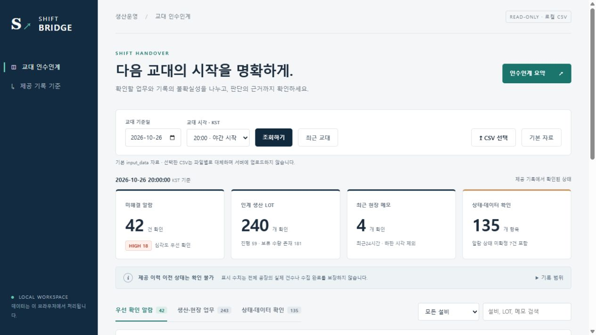

# ShiftBridge · 교대 인수인계 연습 프로젝트

**가상 생산운영 시나리오와 합성 CSV를 활용해 요구사항 정리부터 명세·구현·QA까지 연습한 개인 프로젝트입니다.** 실제 기업의 내부 시스템·운영 데이터·설비 정보는 포함하지 않습니다. 문서에 등장하는 생산운영팀·관리자·승인 기준은 과제 시나리오의 역할과 요구사항을 뜻합니다.

여러 기록을 비교해 인수인계를 만드는 상황을 가정하고, 다음 교대자가 **확인 대상 → 인계 사유 → 원본 근거**를 빠르게 찾는 로컬 브라우저 MVP를 만들었습니다.



## 주요 기능

- KST 08:00·20:00 교대 선택과 과거 시점 조회
- 미해결 알람, 생산·현장 업무, 상태·데이터 확인 영역 분리
- 사건별 알람 중복 제거, 지연 수신·해제·HEARTBEAT 처리
- LOT 정정 버전 적용, 보류 수량 누락·수량 모순·연결 불일치 표시
- 인계 사유와 원본 ID·파일·행·revision 조회
- 영역별 상위 5건의 간결 요약과 전체 상세 요약 조회·복사

표시 순서는 업무 확인을 위한 정렬입니다. 실제 생산 피해나 위험 점수를 산정하지 않습니다.

## 빠른 실행

Node.js 22.13 이상이 필요합니다.

```bash
git clone https://github.com/kanghyunsoon/shiftbridge.git
cd shiftbridge
npm start
```

브라우저에서 http://127.0.0.1:4173 을 엽니다. 앱 실행에는 외부 npm 패키지가 필요하지 않습니다.

샘플 데이터로 확인하려면 **2026-10-26 / 20:00**을 선택하고 조회하세요. 기본 선택값은 실행 시점의 가장 최근 교대입니다. 데이터가 2026년 10월에 한정되어 있으므로 이후 날짜 조회를 실시간 현장 상태로 해석하면 안 됩니다.

## 검증

```bash
npm ci --ignore-scripts
npm run check
```

`npm run check`는 정적검사와 자동 테스트를 실행합니다. 보존된 2026-10-27 검증 결과는 JavaScript 19개 파일 오류·경고 0건, 테스트 65개 통과입니다. 이번 공개 문서 정리에서 테스트를 새로 실행한 결과는 아닙니다.

- [예외 보강 및 정적검사 보고서](deliverables/HARDENING_REPORT.md)
- [실행 출력](deliverables/STATIC_CHECK_RUN.txt)
- [브라우저 기능 검증](deliverables/D07_QA_REPORT.md)
- [시점별 수치·요약 회귀 증거](deliverables/evidence/static-regression.json)

지연 수신, 중복·충돌, 고아 해제, LOT 정정, NULL, 수량 오류, 입력 경쟁 및 복사 실패 등을 검증했습니다. 구현자의 브라우저 확인을 실제 현장 사용성 승인이나 운영 도입 검증으로 간주하지 않습니다.

## 설계와 학습 내용

브라우저 JavaScript ES modules와 Node.js 로컬 정적 서버를 사용했습니다. CSV 읽기, 업무 판정, 화면 렌더링을 분리하고 Spec Kit 기반 명세와 수용 기준을 정리했습니다. 개발 정적검사에는 ESLint와 프로젝트 전용 AST 규칙을 사용합니다.

| 영역 | 위치 |
|---|---|
| CSV 읽기·입력 관리 | `src/data/` |
| 시점·알람·LOT·메모 판정 | `src/domain/` |
| 화면 렌더링·브라우저 동작 | `src/view/`, `src/app.js` |
| 자동 테스트·정적검사 | `tests/`, `scripts/` |
| 기획·명세·의사결정 | `MVP_PLAN.md`, `specs/`, `deliverables/DECISIONS.md` |

핵심 학습 주제는 이벤트 발생 시각과 확인 가능 시각의 구분, 불확실한 상태의 보존, 원본 추적, 시나리오별 회귀 검증입니다. DB·로그인·다중 사용자·실시간 연동·설비 제어·고장 예측은 MVP 범위에 포함하지 않았습니다.

## 데이터와 해석 한계

`input_data/`의 CSV 5종은 연습 환경의 가상 정의와 합성 데이터입니다. [데이터 사전](DATA_GUIDE.md)에서 열 정의를 확인할 수 있습니다. 원본은 앱에서 수정하지 않습니다.

- 알람은 `received_at`을 기준으로 당시 확인 가능 여부를 판단합니다.
- LOT `updated_at`과 메모 `created_at`을 확인 가능 시각으로 간주하는 것은 시나리오상 가정이며 실제 수신 시각을 보장하지 않습니다.
- 제공 이력 이전 상태는 확인할 수 없습니다. 건수는 제공 기록에서 확인된 결과입니다.
- 메모의 조치 완료 여부·실제 생산 피해를 임의로 확정하지 않습니다.
- 일부 입력을 읽을 수 없으면 가능한 결과와 함께 불완전 상태를 표시합니다.

## 문서와 제출 자료

- [MVP 기획서](MVP_PLAN.md) · [상세 명세](specs/001-shift-handover/spec.md)
- [실행 안내](deliverables/RUN.md) · [판정 기준과 한계](deliverables/DECISIONS.md)
- [본문 5쪽 과제 PDF](submission/ShiftBridge_교대인수인계_MVP_과제.pdf)
- [핵심 화면 캡처 5장](submission/screenshots/)

제출 PDF와 화면은 2026-10-28에 작성했습니다. 전체 대화 원문, 로컬 임시 파일, 의존성 캐시와 인증정보는 저장소에 포함하지 않습니다. 공개 저장소의 목적은 학습 과정과 구현 결과 공유입니다.
